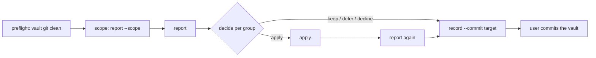

# Vault update

Status: current. Replaces the DRAFT `sync` (see `sync-versioning.md`) for updating existing vaults.

An agent, following the `obsidian-template-vault-update` skill, updates a vault from the commit it was last recorded at (the **base**) to a **target** commit. Three scripts collect the facts and do the writing, and you make each decision:

| Script | Writes | Does |
|---|---|---|
| `mise run vault-update:report <vault>` | nothing | Lists every template change between base and target that reaches the vault, and compares each one with the vault |
| `mise run vault-update:apply <vault>` | vault files | Writes the template side of the entries you chose. Never touches the lock or the config |
| `mise run vault-update:record <vault>` | lock, vault config | Checks that every entry has been decided, then writes the v2 lock (and any `decline` / scope changes) |



## Concepts

| Term | Meaning |
|---|---|
| target | `--to <ref>`. Default: the latest `v*` tag, or the latest tag within the vault's `pin` |
| base | The commit the vault matched at its last `record`, taken from the lock |
| scope | The items the vault takes: `plugin:<id>`, `dir:<name>`, `setting:<name>` |
| entry | One change: a file (`path`) or a JSON key (`path#key`) |
| old / vault / new | The entry's hash at the base, in the vault, and at the target. `-` means absent, `?` means unknown (there is no base) |

Every path is vault-relative. Template paths are the same paths with `template/` in front.

## Lock v2

`.obsidian/template.lock.json`, written only by `record`:

```json
{
  "lockVersion": 2,
  "commit": "9d5029be9f3c11ac9aff416d61bbeb34e2a7b0f2",
  "version": "0.4.0+3.9d5029b",
  "items": ["dir:--Configurations--/Scripts", "plugin:quickadd"],
  "pending": { "--Configurations--/Scripts/QuickAdd/qa-x.js": { "old": "-", "since": "0.4.0" } }
}
```

- `version` is the tag name. For a commit with no tag it is `<tag>+<commits after it>.<sha>`.
- `items` is the scope at the last `record`.
- `pending` holds deferred entries, with the state the vault still matches.
- Keys are sorted and there are no timestamps. The file is written atomically, by temp file and rename.
- The DRAFT `sync` refuses a v2 lock. `compare` reads it, and its header shows `last synced: <version> (<sha>, vault-update)`.

## Scope

The scope is resolved like the sync wizard resolves it. For each of plugins, dirs and settings, the first source that is present wins:

1. CLI: `--plugins`, `--dirs`, `--settings`
2. The vault's `.obsidian/sync.config.json`: `defaultPlugins`, `defaultDirs`, `defaultSettings`
3. The lock's `items`. This means a vault with no config keeps what it actually synced
4. The repo's `sync.config.json`

The rest follows from that:

- Directories linked to a plugin are added with that plugin (QuickAdd → `--Configurations--/Scripts`, and so on).
- `exclude` removes items.
- `record --save-scope` writes the three `default*` keys and keeps every other key.

The lock's `items` and the current scope can differ:

- An item in scope but not in the lock is **newly selected**. It is installed file by file with no base: identical files are `done`, and differing files are conflicts.
- An item in the lock but not in scope is **deselected**. Its files stay in place and are listed.
- An item in the template but not in scope is **available**. It is listed and nothing is done with it.

## Base

| Lock | Base per item |
|---|---|
| v2 | `commit`, for items in `items` |
| v1, `templateVersion` is a tag | That tag |
| v1, `working-tree` | The newest template commit whose files for the item equal the lock's recorded hashes exactly (ignoring data files). With no exact match, the closest commit is reported, and `--base <ref>` accepts it |
| No lock, or a newly selected item | None |

For v1, the old state of a file is its recorded hash. That is correct even for files whose conflict the draft skipped. The old state of a plugin `data.json` is the tag in `dataVersion`. When `dataVersion` is missing or `working-tree`, it is unknown.

## Entries

The report collects candidates per in-scope item: every file at the target, at the base, or recorded in a v1 lock, plus every pending entry. A file that is the same at the base and at the target is skipped, unless it is pending.

| old → new | vault | State |
|---|---|---|
| any | = new | `done` |
| known | = old | `apply` (`apply-auto` for plugin `data.json` keys with `syncDataJson`) |
| known | other | `conflict` |
| `?` | absent | `apply-nobase` |
| `?` | other | `conflict` |

After that, these rules apply in order:

1. A protected path becomes `protected`.
2. A match in `decline` becomes `declined`.
3. A key that a vault patch names becomes `done`.

`--audit` also lists files that the template did not change in the range but that differ in the vault, as `drift`.

### Moves

`git diff -M` runs between the base and the target over the whole of `template/`, so moves between items are found too. An added file whose source path still holds the old content in the vault becomes a `rename` entry:

| vault at old path | vault at new path | State |
|---|---|---|
| old content | absent | `apply`, which moves the file |
| absent | new content | `done` |
| anything else | | `conflict` |

### JSON keys

Plugin `data.json` and the JSON settings files (such as `app.json`) are compared key by key:

- Objects recurse into their keys.
- Arrays whose elements are all objects with a unique `id` (QuickAdd `choices`) recurse by id. Their keys look like `choices[<id>].macro.name`.
- Other arrays and scalars are compared whole.
- Without a base, the vault's document stands in for the base, and keys that only the vault has are never touched.

`genericPreviewCache.json` and `.DS_Store` are ignored.

### Groups and dependencies

Entries are grouped by the first commit in the range that changed them, together with that commit's changelog lines. For keys, the report diffs each commit that touched the file. Entries with no commit are grouped as `Deferred earlier`, `Newly selected <item>`, or `No recorded base`.

The report also checks dependencies. A QuickAdd choice depends on each `.js` path it names. A script depends on each `vaultRequire(app, "lib/...")` it calls. When an entry would be applied but something it needs will not be in the vault, because it is declined or missing, the report shows a dependency warning.

### Migrations

The report lists:

- `migrations/<version>.ts` files added in the range that a v1 lock has not recorded as run
- `**Migration**` changelog notes from commits that changed an in-scope item

The agent carries out the steps by hand.

## Decisions

| Decision | Allowed for | Stored | Next update |
|---|---|---|---|
| apply | apply states, and conflicts with `apply --take-template` | nothing | — |
| keep | conflicts only | nothing | Asked again only if the template changes the entry again |
| defer | any open entry | `pending` in the lock (`old`: the entry's old state, `?` stays unknown) | Offered again, compared with the stored old state |
| decline | any open entry | `decline` in the vault config (`"path"`, `"glob/**"` or `"path#key"`, with a label) | Never offered. A decline that the template no longer matches is listed as stale |

`record` refuses, writes nothing and exits 1 in any of these cases:

- an open entry (apply states or conflict) has no decision
- a `--keep` names something that is not a conflict
- a `--defer` names an unknown entry
- a `--decline` matches no open entry

## Migrating a v1 lock

A vault with a v1 lock (from the draft `sync`) is migrated on its first update:

1. The base is resolved per item, as in the Base table.
2. The update is decided, applied and recorded as usual.
3. `record` copies the old lock to `.obsidian/template.lock.v1.json`, then writes v2. The v1 `migrations` list is not carried over, because the v2 commit range covers it.

## Limitations

- The scope is resolved from `state.json` in the working tree, as in the draft.
- Text files are not merged automatically. For a conflicting text file, the skill runs `git merge-file`, using the old blob as the base.
- Moves are found by git's similarity check (`-M`, 50%). A file that was moved and heavily edited shows up as an add, and its old copy stays in the vault.
- A move is detected only when the base commit is known.
